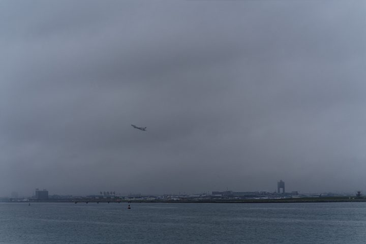

<table>
<tr>
<td width="33%" valign="top">
<a href="https://photo.banast.as"><picture><source media="(prefers-color-scheme: dark)" srcset="assets/head-photo-dark.svg"></picture></a>  Sony A7R III 85mm &middot; f/5.6 &middot; 1/1000s &middot; ISO 640
</td>
<td width="33%" valign="top">
<a href="https://blog.banast.as"><picture><source media="(prefers-color-scheme: dark)" srcset="assets/head-blog-dark.svg"></picture></a>  October 20, 2026 <b>John Lear and the Alien Cover-Up</b>
</td>
<td width="33%" valign="top">
<a href="https://floor1point2.com"><picture><source media="(prefers-color-scheme: dark)" srcset="assets/head-floor-dark.svg"></picture></a>  Floor 1.2 Native apps for the Mac and iPhone
</td>
</tr>
</table>

<!-- This file is generated by scripts/build_readme.py from README.template.md. Edit the template, not README.md. -->
